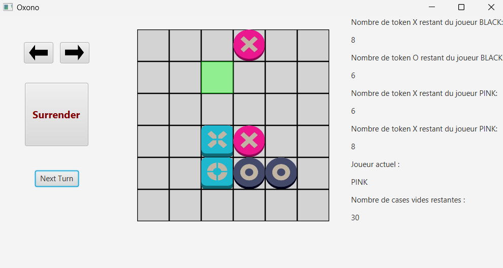

# Oxono

[](https://github.com/MGpro-grammer/oxono/actions/workflows/ci.yml)


A desktop implementation of the **Oxono** abstract strategy board game, written in Java 21 with a JavaFX interface. Play against a computer opponent on a board of configurable size, with undo/redo of every action.



## Features

- JavaFX interface with live preview of every action (green = valid, red = invalid)
- Configurable board size (any even number ≥ 6)
- Computer opponent (level 0: random valid moves)
- Unlimited undo / redo
- Surrender button (hold for 5 seconds)
- Text-based console mode for two human players
- 19 JUnit 5 unit tests covering the game model

## Game rules

Two players (pink and black) share two totems, **X** and **O**. On each turn, a player:

1. **Moves a totem** in a straight line (row or column) to an empty cell, without jumping over pieces.
   An enclosed totem may jump to the first empty cell in a line; a fully blocked totem may go to any empty cell.
2. **Places a token** of that totem's symbol, in their own color, on a cell orthogonally adjacent to the totem
   (anywhere if no adjacent cell is free).

The first player to align **4 tokens of the same color or the same symbol** horizontally or vertically wins.
The game is a draw when both players run out of tokens (8 X and 8 O each on a 6×6 board).

## Getting started

### Prerequisites

- **JDK 21 or later** (e.g. [Eclipse Temurin](https://adoptium.net/))
- Git

No Maven installation is required: the project ships with the Maven Wrapper.

### Run the game

```bash
git clone https://github.com/MGpro-grammer/oxono.git
cd oxono
./mvnw javafx:run        # macOS / Linux
.\mvnw.cmd javafx:run    # Windows (PowerShell)
```

### Run the tests

```bash
./mvnw verify            # macOS / Linux
.\mvnw.cmd verify        # Windows (PowerShell)
```

The console version can be started from your IDE through `io.github.mgprogrammer.oxono.console.Console`.

## How to play

| Action                  | Control                                    |
|-------------------------|--------------------------------------------|
| Select a totem          | Left-click on the totem                    |
| Move the selected totem | Right-click on the destination cell        |
| Place a token           | Left-click on an empty cell                |
| End your turn           | **Next Turn** button                       |
| Undo / redo             | Left / right arrow buttons                 |
| Surrender               | Press and hold **Surrender** for 5 seconds |

You play pink and start the game; the computer plays black.

## Architecture

The application follows the **Model-View-Controller** architecture and applies several design patterns:

| Pattern      | Where                                                                                           | Purpose                                  |
|--------------|-------------------------------------------------------------------------------------------------|------------------------------------------|
| **Observer** | `Game` (subject) → `ViewBoard`, `ViewData`, `Console`                                           | Refresh the views after every game event |
| **Command**  | `MoveTotemCommand`, `InsertTokenCommand`, `NextTurnCommand`, managed by `CommandManager`         | Undo / redo of every action              |
| **Strategy** | `MoveStrategy` / `InsertStrategy`, implemented by `RandomMoveStrategy` / `RandomInsertStrategy` | Pluggable behavior of the computer opponent |

```
src/main/java/io/github/mgprogrammer/oxono/
├── Main.java        # JavaFX entry point
├── model/           # Game rules: Board, Game, Player, Robot, pieces, commands
├── view/            # JavaFX views: menu, board, player data, controls
├── controller/      # Mediates between the views and the model
├── console/         # Text-based interface
├── event/           # Events sent to the observers
├── strategy/        # Computer opponent strategies
└── util/            # Observer, Observable, Command interfaces and exception
```

## Credits

*Oxono* is a board game designed by Jérémy Partinico and published by Cosmoludo.
This repository is an unofficial, non-commercial implementation; it is not affiliated with or endorsed by the publisher.
All images in this repository are original artwork by the author.

## License

This project is released under the [MIT License](LICENSE).